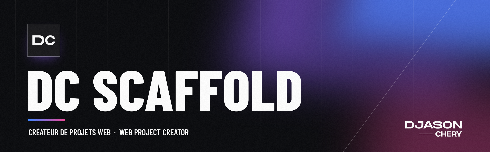
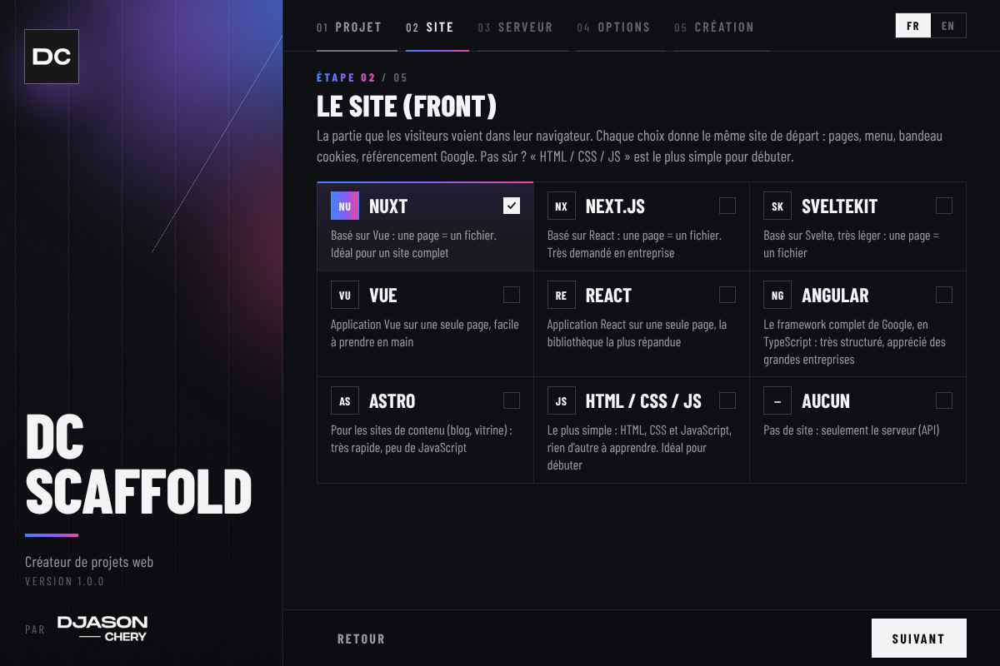
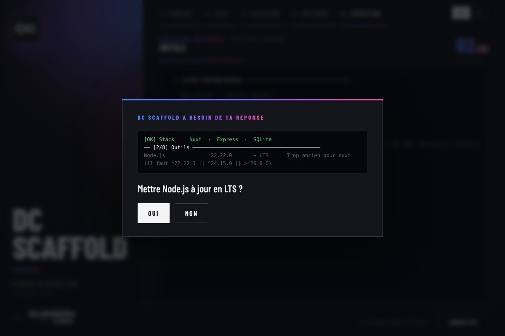
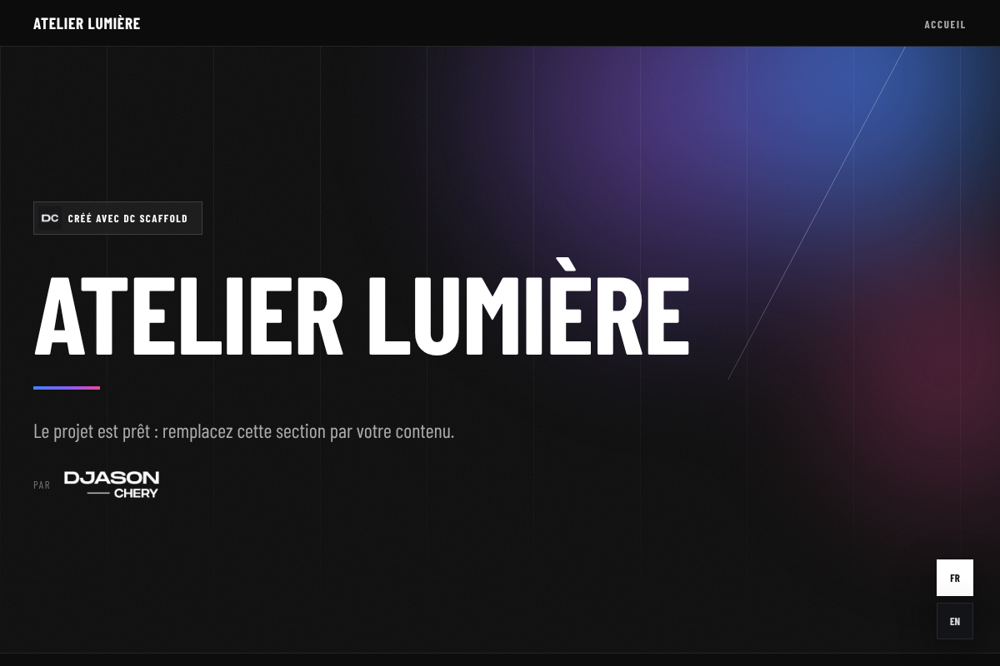
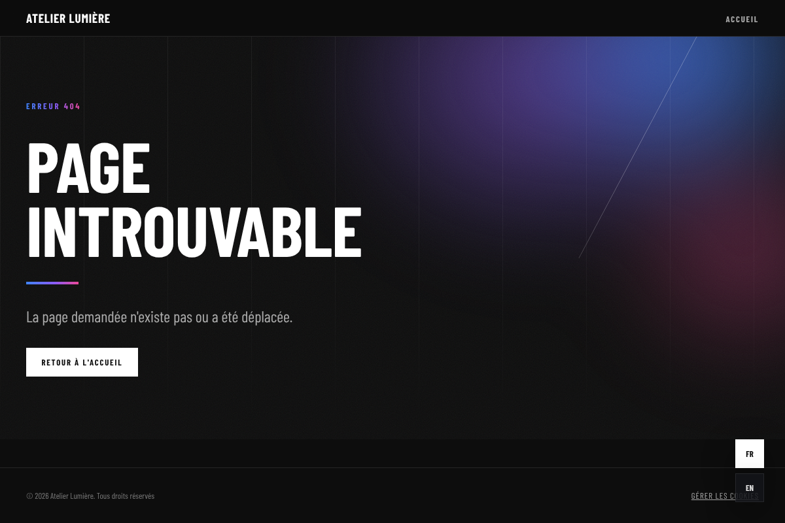

<p align="center">
  
</p>

<p align="center">
  
  
  
</p>

<p align="center">
  <a href="#français"><b>FRANÇAIS</b></a> &nbsp;&nbsp;·&nbsp;&nbsp; <a href="#english"><b>ENGLISH</b></a>
</p>


## Français

### Présentation

**DC Scaffold** crée un projet web complet en quelques minutes : tu choisis un front, un back end et une base de données, il installe ce qui manque sur la machine et génère un projet prêt à coder.

Pas besoin d'être expert : le **front** est le site que voient les visiteurs, le **back end** est le serveur qui garde les données (comptes, articles, formulaires...). DC Scaffold installe et relie tout pour toi, puis explique chaque fichier dans le `README.md` du projet.

Tous les projets partagent la même architecture, quel que soit le framework :

- `backend/` pour le back end, `frontend/` pour le front
- les mêmes helpers (`ResponseHelper`, `RequestHelper`, `DatabaseHelper`) et le même format de réponse JSON
- des **routes d'API automatiques** : une méthode `getAll()` dans `ProductsController` donne `GET /products`
- MySQL et phpMyAdmin dans Docker quand le projet en a besoin
- un `start.bat` pour tout lancer, installer, compiler

### Aperçu

<table>
  <tr>
    <td width="50%"></td>
    <td width="50%"></td>
  </tr>
  <tr>
    <td width="50%"></td>
    <td width="50%"></td>
  </tr>
</table>

<sub>La fenêtre de DC Scaffold, la création suivie en direct, puis la page d'accueil et la page 404 d'un site créé : le même style partout.</sub>

### Fonctionnalités

- **Une vraie fenêtre d'application** : DC Scaffold s'ouvre dans sa propre fenêtre, au style de l'installateur (fond sombre, Barlow Condensed, angles nets) ; tout se choisit en quelques clics et la création se suit en direct
- **Installation des prérequis selon tes choix** : Node.js, Git, Docker Desktop, PHP et Composer (pour un serveur PHP) et Visual Studio Code (avec GitHub Copilot et les extensions utiles pour les stacks choisis : Vue, Svelte, Astro, PHP, Laravel) sont installés automatiquement s'ils manquent (via winget, après accord), Docker est démarré s'il est arrêté, les extensions manquantes du PHP local peuvent être activées dans le `php.ini`
- **Versions toujours à jour** : vérification sur npm et Packagist avant chaque création, une nouvelle version majeure est proposée mais jamais imposée
- **Versions testées chaque semaine** : un robot crée et compile chaque stack avec les dernières versions ; celles qui marchent sont validées, et DC Scaffold télécharge les stacks à jour tout seul, sans réinstallation (voir [Robot de compatibilité](#robot-de-compatibilité-et-catalogue))
- **Base de données** : MySQL (dernière LTS, dans Docker, avec phpMyAdmin) pour les back ends PHP, accès par `mysqli` ou `PDO` ; MySQL ou SQLite (un simple fichier, sans serveur) pour Nitro et Express, avec les mêmes méthodes
- **Même architecture front partout** : `components/ui` et `views`, `composables`, `middleware`, `pages`, `plugins` (langues + traductions), `stores` (Pinia, Zustand, Svelte `$state`, signals d'Angular ou sans dépendance), `utils` (SEO, cookies), `assets/css` ; AppShell (chargement, en-tête, pied de page, retour en haut, langues), bannière cookies, page 404, SEO, `sitemap.xml` et `robots.txt` prêts dans chaque front
- **Design de DC Scaffold, ou page blanche** : chaque site s'ouvre avec le design de DC Scaffold (thème sombre, page d'accueil « Et maintenant ? ») ; `design: false` dans `frontend/dc-scaffold.config.js` donne un site vide au style simple, et plus rien du design de DC Scaffold ne va dans le build
- **Site en une ou deux langues** (français, anglais) : avec deux langues, boutons de langue et textes traduits ; avec une seule, les textes sont écrits directement dans les composants, sans système de traduction
- **Un seul `README.md` par projet**, dans la langue choisie au démarrage : comment lancer le projet, où changer les couleurs, les textes, les langues, les cookies, ajouter une page ou une route
- **Code commenté dans ta langue** : les commentaires du code généré sont en français ou en anglais, comme le README
- **Français ou anglais**, choix mémorisé
- **Extensible** : chaque front et back end est décrit par un fichier `stack.json`, on en ajoute sans toucher au code

### Fronts et back ends

| Fronts | Back ends |
| ------ | --------- |
| Nuxt | Slim 4 |
| Next.js | Laravel |
| SvelteKit | Symfony |
| Vue (Vite) | PHP sans framework |
| React (Vite) | Nitro (avec n'importe quel front) |
| Angular | Express |
| Astro | Aucun (site statique) |
| HTML / CSS / JS | |
| Aucun (API seule) | |

Docker n'est utilisé que si le projet en a besoin : back end PHP, base MySQL ou front HTML/CSS/JS. Un front Nuxt avec une API Express en SQLite tourne entièrement sans Docker.

### Prérequis

- Windows 10 ou 11
- Le reste est proposé à l'installation au premier lancement : **Node.js** (fronts et back ends JavaScript), **Docker Desktop** (PHP, MySQL), **Git**, **Visual Studio Code** avec **GitHub Copilot** (à connecter une fois avec ton compte GitHub)
- **PHP** et **Composer** sont proposés pour les serveurs PHP (la même version de PHP que Docker) ; sans eux, l'image Docker officielle `composer` est utilisée

### Installation

1. Télécharge **`DCScaffold-Setup.exe`** (onglet *Releases*, ou à la racine de ce dépôt)
2. Lance-le et suis l'assistant (français ou anglais selon Windows) : DC Scaffold s'installe dans `C:\Users\<toi>\AppData\Local\Programs\DC Scaffold`, sans droits administrateur
3. Ouvre **DC Scaffold** depuis le menu Démarrer ou le bureau : il s'ouvre dans sa fenêtre (affichée par Microsoft Edge, déjà présent dans Windows). `dcscaffold` dans un terminal lance la version console

**Mises à jour** : au démarrage, DC Scaffold regarde s'il existe une nouvelle version sur GitHub ; un bouton « Mettre à jour » apparaît alors dans la fenêtre (un clic, la nouvelle version remplace l'ancienne). Tes réglages et tes stacks personnels (`%APPDATA%\DC Scaffold\stacks`) sont gardés.
**Désinstallation** : menu Démarrer → DC Scaffold → Désinstaller DC Scaffold (ou Paramètres Windows → Applications). Tout est supprimé : programme, raccourcis, commande `dcscaffold`, entrée Windows ; coche « Mes réglages et mes stacks personnels » pour supprimer aussi `%APPDATA%\DC Scaffold`.

Au premier lancement, Windows SmartScreen peut afficher « Windows a protégé votre ordinateur », car l'exe n'est pas encore signé : *Informations complémentaires* → *Exécuter quand même*.

### Utilisation

Dans la fenêtre, cinq étapes :

1. **Projet** : nom et dossier (bouton « Parcourir »)
2. **Front** et 3. **Back end** : une carte par framework
4. **Options** : base de données (et `mysqli` / `PDO` en PHP), langues du site, Git, VS Code + Copilot, dernières versions majeures, ports, avec le récapitulatif
5. **Création** : outils vérifiés et installés, dernières versions, fichiers, dépendances et premier commit, suivis en direct. Chaque décision (installer ou mettre à jour Node.js, démarrer Docker, passer à une nouvelle version majeure...) t'est demandée dans la fenêtre, avec ce qui l'explique. Puis « Lancer le projet », « Ouvrir le dossier » ou « Ouvrir dans VS Code »

Le bouton **Version console** (sous le titre) ouvre le même moteur dans une console PowerShell.

Dans le projet créé : `start.bat` puis `D` pour lancer le développement. Le français ou l'anglais se choisit en haut à droite de la fenêtre.

Ligne de commande (version console, avec les mêmes choix sous forme de questions) :

```
dcscaffold -Lang fr -Name "Mon site" -Front vanilla -Back none
dcscaffold -Name "Boutique" -Front nuxt -Back slim -Database mysql -Driver pdo -ApiPort 8010
```

| Option | Valeurs |
| ------ | ------- |
| `-Front` | `nuxt`, `next`, `sveltekit`, `vue`, `react`, `astro`, `vanilla`, `none` |
| `-Back` | `slim`, `laravel`, `symfony`, `php`, `nitro`, `express`, `none` |
| `-Database` | `mysql`, `sqlite` (Nitro et Express ; les back ends PHP utilisent toujours MySQL) |
| `-Driver` | `mysqli`, `pdo` (Slim et PHP) |
| Autres | `-Lang fr\|en`, `-Destination`, `-Languages fr\|en\|fr,en`, `-AppPort`, `-ApiPort`, `-PmaPort`, `-DbPort`, `-UseLatest`, `-SkipToolCheck`, `-SkipInstall`, `-NoGit`, `-NoEditor`, `-Force` |

### Projets générés

```
mon-projet/
├── backend/             back end (contrôleurs, helpers, routes automatiques)
├── frontend/            front (client api.js, .env, .htaccess de production)
├── mysql/               configuration MySQL (si base de données)
├── docker-compose.yml   seulement les services utiles
├── start.bat            D développement · S stop · I installer · B build...
└── README.md            démarrer + où modifier quoi (couleurs, textes, langues, cookies, pages, API), dans ta langue
```

| Méthode du contrôleur | Route |
| --------------------- | ----- |
| `getAll` | `GET /products` |
| `getOne` | `GET /products/{id}` |
| `create` | `POST /products` |
| `update` | `PUT` / `PATCH /products/{id}` |
| `delete` | `DELETE /products/{id}` |

Toute autre route se déclare sur sa méthode : `#[Route('POST', '/{id}/mark-shipped')]` en PHP, `static routes = { ... }` en JavaScript.

### Ajouter un front ou un back end

Copie le dossier le plus proche dans `stacks/fronts` ou `stacks/backs` et adapte son `stack.json`. Guide complet : [`stacks/README.md`](stacks/README.md) (français) · [`stacks/README.en.md`](stacks/README.en.md) (English).

### Robot de compatibilité et catalogue

Chaque lundi (et après chaque modification de `stacks/` sur `master`), le workflow [`compatibility.yml`](.github/workflows/compatibility.yml) lance [`tools/robot/robot.py`](tools/robot/robot.py) :

1. il cherche les dernières versions **stables** de chaque paquet sur npm et Packagist : une nouvelle version majeure n'est testée que 30 jours après sa sortie, le temps des premières corrections ; pour les images Docker (`stacks/infra/versions.json`), la dernière **MySQL LTS** et le dernier **PHP** sorti depuis 6 mois, testés avec une vraie requête sur MySQL et tous les serveurs PHP ;
2. il crée un projet avec chaque stack et vérifie qu'il marche (compilation du site, démarrage du serveur) ;
3. une nouvelle version majeure qui marche devient la version validée (`stable` dans `stack.json`) ; une version qui casse ouvre un ticket GitHub, et DC Scaffold reste sur celle qui marche ;
4. il publie le catalogue dans la release `catalog` : `catalog.json` (version des stacks) et `stacks.zip`.

À chaque ouverture, DC Scaffold lit `catalog.json` et télécharge les stacks plus récents que les siens (vérifiés par leur empreinte sha256) dans `%LOCALAPPDATA%\DC Scaffold\catalog`. Sans internet, il garde ceux de l'installation. Tu n'interviens que si le robot ouvre un ticket.

### Structure du dépôt

```
├── DCScaffold-Setup.exe installateur Windows : un seul fichier à télécharger
├── DCScaffold.bat       lance le moteur de ce dossier sans rien installer (développement)
├── VERSION              numéro de version, le seul endroit à modifier
├── engine/              moteur PowerShell, textes fr / en, bannière
├── stacks/              modèles de tous les projets (modifiables sans recompiler), version dans stacks/version.txt
├── tools/robot/         robot de compatibilité (teste les stacks chaque semaine)
├── assets/              logo et icône
├── installer/           installateur Windows (NSIS) : assistant, désinstallation, build.sh / build.ps1
├── launcher/            code source Go de DCScaffold.exe : la fenêtre (ui/), le serveur local, les mises à jour
└── .github/workflows/   compilation de l'exe, publication des versions, robot de compatibilité
```

### Compiler l'exe

Voir [`installer/README.md`](installer/README.md). Un tag `v*` poussé sur GitHub compile `DCScaffold-Setup.exe` et le publie dans *Releases* : les DC Scaffold installés le proposent alors en mise à jour.

### Feuille de route

- Signature de l'exe (plus d'avertissement SmartScreen)
- Versions macOS et Linux du lanceur
- Nouveaux stacks (AdonisJS, Django...)

### Licence

Tous droits réservés © 2026 Djason CHERY — voir [`LICENSE`](LICENSE).


## English

### Overview

**DC Scaffold** creates a complete web project in minutes: pick a front, a back end and a database, it installs what the machine is missing and generates a project ready to code.

No need to be an expert: the **front** is the site visitors see, the **back end** is the server that keeps the data (accounts, articles, forms...). DC Scaffold installs and connects everything for you, then explains every file in the `README.md` of the project.

Every project shares the same architecture, whatever the framework:

- `backend/` for the back end, `frontend/` for the front
- the same helpers (`ResponseHelper`, `RequestHelper`, `DatabaseHelper`) and the same JSON response format
- **automatic API routes**: a `getAll()` method in `ProductsController` gives `GET /products`
- MySQL and phpMyAdmin in Docker when the project needs them
- a `start.bat` to run, install and build everything

### Preview

<table>
  <tr>
    <td width="50%"></td>
    <td width="50%"></td>
  </tr>
  <tr>
    <td width="50%"></td>
    <td width="50%"></td>
  </tr>
</table>

<sub>The DC Scaffold window, the creation followed live, then the home page and the 404 page of a created site: the same look everywhere.</sub>

### Features

- **A real application window**: DC Scaffold opens in its own window, in the style of the installer (dark background, Barlow Condensed, sharp corners); everything is picked in a few clicks and the creation is followed live
- **Prerequisites installed for your choices**: Node.js, Git, Docker Desktop, PHP and Composer (for a PHP server) and Visual Studio Code (with GitHub Copilot and the extensions useful for the chosen stacks: Vue, Svelte, Astro, PHP, Laravel) are installed when missing (through winget, after asking), Docker is started when stopped, missing extensions of the local PHP can be enabled in `php.ini`
- **Always up to date**: npm and Packagist are checked before each project; a new major version is offered, never forced
- **Versions tested every week**: a robot creates and builds every stack with the latest versions; the ones that work are validated, and DC Scaffold downloads the updated stacks by itself, without reinstalling (see [Compatibility robot](#compatibility-robot-and-catalog))
- **Database**: MySQL (latest LTS, in Docker, with phpMyAdmin) for the PHP back ends, through `mysqli` or `PDO`; MySQL or SQLite (a plain file, no server) for Nitro and Express, with the same methods
- **Same front architecture everywhere**: `components/ui` and `views`, `composables`, `middleware`, `pages`, `plugins` (languages + translations), `stores` (Pinia, Zustand, Svelte `$state`, Angular signals or dependency-free), `utils` (SEO, cookies), `assets/css`; AppShell (loader, header, footer, back to top, languages), cookie banner, 404 page, SEO, `sitemap.xml` and `robots.txt` ready in every front
- **DC Scaffold design, or a blank page**: every site opens with the DC Scaffold design (dark theme, "What next?" home page); `design: false` in `frontend/dc-scaffold.config.js` gives a blank site with a simple style, and nothing of the DC Scaffold design goes into the build any more
- **One- or two-language sites** (French, English): with two, language buttons and translated texts; with one, the texts are written straight into the components, with no translation system
- **One `README.md` per project**, in the language picked at start: how to run the project, where to change colors, texts, languages, cookies, add a page or a route
- **Code commented in your language**: the comments of the generated code are in French or English, like the README
- **French or English**, remembered between runs
- **Extensible**: every front and back end is described by a `stack.json` file; add your own without touching the code

### Fronts and back ends

| Fronts | Back ends |
| ------ | --------- |
| Nuxt | Slim 4 |
| Next.js | Laravel |
| SvelteKit | Symfony |
| Vue (Vite) | PHP without framework |
| React (Vite) | Nitro (with any front) |
| Angular | Express |
| Astro | None (static site) |
| HTML / CSS / JS | |
| None (API only) | |

Docker is only used when the project needs it: PHP back end, MySQL database or HTML/CSS/JS front. A Nuxt front with an Express API on SQLite runs entirely without Docker.

### Requirements

- Windows 10 or 11
- Everything else is offered for installation on first run: **Node.js** (JavaScript fronts and back ends), **Docker Desktop** (PHP, MySQL), **Git**, **Visual Studio Code** with **GitHub Copilot** (to connect once with your GitHub account)
- **PHP** and **Composer** are offered for the PHP servers (the same PHP version as Docker); without them, the official `composer` Docker image is used

### Installation

1. Download **`DCScaffold-Setup.exe`** (*Releases* tab, or at the root of this repository)
2. Run it and follow the wizard (French or English, like Windows): DC Scaffold installs into `C:\Users\<you>\AppData\Local\Programs\DC Scaffold`, no administrator rights needed
3. Open **DC Scaffold** from the Start menu or the desktop: it opens in its window (shown by Microsoft Edge, already part of Windows). `dcscaffold` in a terminal runs the console version

**Updates**: on start, DC Scaffold checks GitHub for a new version; an "Update" button then shows in the window (one click, the new version replaces the old one). Your settings and custom stacks (`%APPDATA%\DC Scaffold\stacks`) are kept.
**Uninstall**: Start menu → DC Scaffold → Uninstall DC Scaffold (or Windows Settings → Apps). Everything is removed: program, shortcuts, `dcscaffold` command, Windows entry; tick "My settings and custom stacks" to also delete `%APPDATA%\DC Scaffold`.

On first run, Windows SmartScreen may show "Windows protected your PC" because the exe is not signed yet: *More info* → *Run anyway*.

### Usage

Five steps in the window:

1. **Project**: name and folder ("Browse" button)
2. **Front** and 3. **Back end**: one card per framework
4. **Options**: database (and `mysqli` / `PDO` in PHP), languages of the site, Git, VS Code + Copilot, latest major versions, ports, with the summary
5. **Creation**: tools checked and installed, latest versions, files, dependencies and first commit, followed live. Every decision (install or update Node.js, start Docker, move to a new major version...) is asked in the window, with what explains it. Then "Start the project", "Open the folder" or "Open in VS Code"

The **Console version** button (under the title) opens the same engine in a PowerShell console.

In the new project: `start.bat` then `D` to start developing. French or English is picked at the top right of the window.

Command line (console version, with the same choices as questions):

```
dcscaffold -Lang en -Name "My site" -Front vanilla -Back none
dcscaffold -Name "Shop" -Front nuxt -Back slim -Database mysql -Driver pdo -ApiPort 8010
```

| Option | Values |
| ------ | ------ |
| `-Front` | `nuxt`, `next`, `sveltekit`, `vue`, `react`, `astro`, `vanilla`, `none` |
| `-Back` | `slim`, `laravel`, `symfony`, `php`, `nitro`, `express`, `none` |
| `-Database` | `mysql`, `sqlite` (Nitro and Express; PHP back ends always use MySQL) |
| `-Driver` | `mysqli`, `pdo` (Slim and PHP) |
| Others | `-Lang fr\|en`, `-Destination`, `-Languages fr\|en\|fr,en`, `-AppPort`, `-ApiPort`, `-PmaPort`, `-DbPort`, `-UseLatest`, `-SkipToolCheck`, `-SkipInstall`, `-NoGit`, `-NoEditor`, `-Force` |

### Generated projects

```
my-project/
├── backend/             back end (controllers, helpers, automatic routes)
├── frontend/            front (api.js client, .env, production .htaccess)
├── mysql/               MySQL configuration (with a database)
├── docker-compose.yml   only the services in use
├── start.bat            D develop · S stop · I install · B build...
└── README.md            getting started + where to change what (colors, texts, languages, cookies, pages, API), in your language
```

| Controller method | Route |
| ----------------- | ----- |
| `getAll` | `GET /products` |
| `getOne` | `GET /products/{id}` |
| `create` | `POST /products` |
| `update` | `PUT` / `PATCH /products/{id}` |
| `delete` | `DELETE /products/{id}` |

Any other route is declared on its method: `#[Route('POST', '/{id}/mark-shipped')]` in PHP, `static routes = { ... }` in JavaScript.

### Adding a front or a back end

Copy the closest folder in `stacks/fronts` or `stacks/backs` and adapt its `stack.json`. Full guide: [`stacks/README.en.md`](stacks/README.en.md) (English) · [`stacks/README.md`](stacks/README.md) (français).

### Compatibility robot and catalog

Every Monday (and after every change of `stacks/` on `master`), the workflow [`compatibility.yml`](.github/workflows/compatibility.yml) runs [`tools/robot/robot.py`](tools/robot/robot.py):

1. it looks for the latest **stable** version of every package on npm and Packagist: a new major version is only tested 30 days after its release, time for the first fixes; for the Docker images (`stacks/infra/versions.json`), the latest **MySQL LTS** and the latest **PHP** out for 6 months, tested with a real query on MySQL and every PHP server;
2. it creates a project with every stack and checks it works (build of the site, start of the server);
3. a new major version that works becomes the validated version (`stable` in `stack.json`); one that breaks opens a GitHub issue, and DC Scaffold stays on the one that works;
4. it publishes the catalog in the `catalog` release: `catalog.json` (stacks version) and `stacks.zip`.

Every time it opens, DC Scaffold reads `catalog.json` and downloads the stacks newer than its own (checked with their sha256 fingerprint) into `%LOCALAPPDATA%\DC Scaffold\catalog`. Without internet, it keeps the ones of the installation. You only step in when the robot opens an issue.

### Repository layout

```
├── DCScaffold-Setup.exe Windows installer: the only file to download
├── DCScaffold.bat       runs the engine of this folder without installing anything (development)
├── VERSION              version number, the only place to change it
├── engine/              PowerShell engine, fr / en texts, banner
├── stacks/              templates of every project (editable without rebuilding), version in stacks/version.txt
├── tools/robot/         compatibility robot (tests the stacks every week)
├── assets/              logo and icon
├── installer/           Windows installer (NSIS): wizard, uninstaller, build.sh / build.ps1
├── launcher/            Go source of DCScaffold.exe: the window (ui/), the local server, updates
└── .github/workflows/   builds the exe, publishes releases, compatibility robot
```

### Building the exe

See [`installer/README.md`](installer/README.md). Pushing a `v*` tag to GitHub builds `DCScaffold-Setup.exe` and publishes it in *Releases*: installed copies of DC Scaffold then offer it as an update.

### Roadmap

- Signed exe (no SmartScreen warning)
- macOS and Linux launchers
- More stacks (AdonisJS, Django...)

### License

All rights reserved © 2026 Djason CHERY — see [`LICENSE`](LICENSE).
